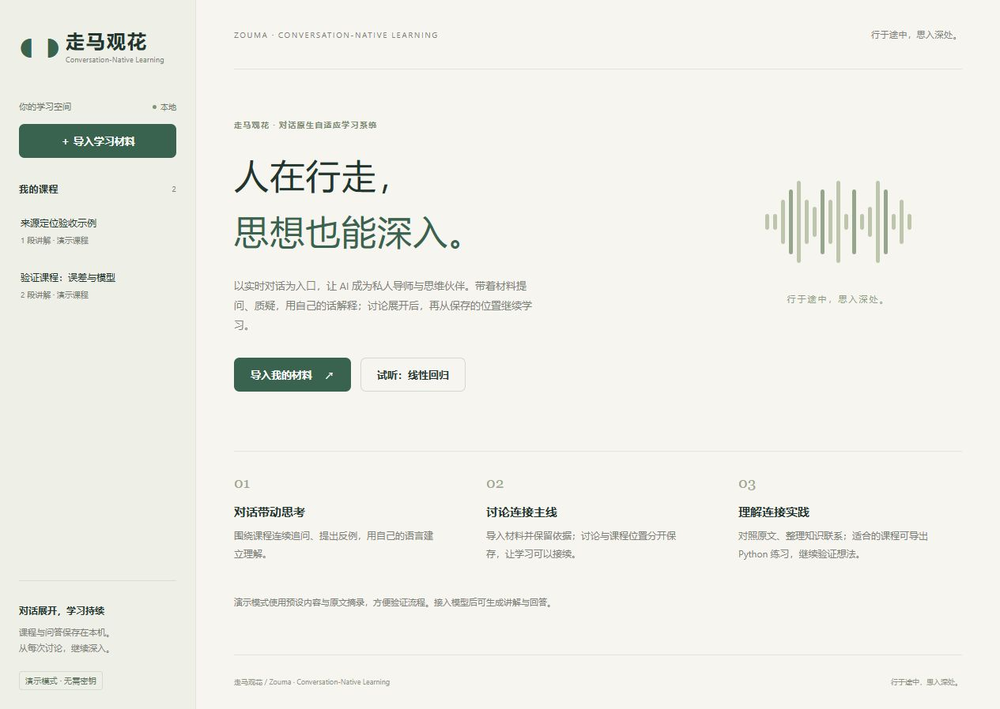

# 走马 · Zouma

**行在途中，思入深处。**

**Conversation-Native Learning** · Conversation-Native Adaptive Learning System（对话原生自适应学习系统）

Zouma is an open-source, conversation-native adaptive learning system driven by an AI teaching agent. Real-time voice is an important entry point for asking, challenging, explaining, and continuing a lesson across contexts. Early development; feedback in Chinese or English is welcome. See [Contributing](CONTRIBUTING.md).

走马是一个以对话为核心、以 AI 教学 Agent 为驱动、能够跨场景持续学习的开源自适应学习系统。“走马”取行动之意，承载着**人在行走，思想却能深入**的愿景。散步与通勤是最初的使用场景，让学习摆脱固定书桌与屏幕的限制、在主动思考中持续深入，是长期方向。

用户导入 Lecture、教材或论文后，可以围绕课程随时打断、追问、质疑、用自己的语言解释概念，并在讨论后准确回到主线。课程位置与讨论恢复点由应用持久保存，AI 同时承担私人导师和思维讨论伙伴的角色。实时语音是当前重点入口；长期方向是让语音、文本、图表、数学推导与编程实践连续衔接，通过知识整合与持续反馈逐步调整学习路径。

**当前为 v0.2 本地单用户开发版，P0 尚未完成验收。** 项目开源收集产品建议、试用反馈和代码贡献。已沿用原有 FastAPI、SQLite、材料导入和测试，新增实时语音适配、显式教学编排与异步竞态保护。当前验证没有使用真实服务密钥；自动化模拟验证不能代替真实语音与模型联调。实际验证见 [VALIDATION](docs/VALIDATION.md)。采用 MIT 许可。

当前代码聚焦「材料导入 → 讲授 → 打断讨论 → 恢复主线 → 保存位置」闭环。长期学习者记忆、知识掌握追踪、自适应教学策略，以及多模态之间的连续切换仍在路线图中；产品定位不代表这些能力已经实现。

品牌规范见 [BRAND](docs/BRAND.md)。建议仓库名为 `zouma-learning`；本次保留现有 GitHub 地址和安装标识，避免影响已有链接、脚本及本地数据。

## 一起把学习体验做得更好

欢迎通过 [Issues](https://github.com/sunruian350-Lysander/audio-first-learning-agent/issues) 分享建议；不需要写代码，也不需要认同现有方案。中文和 English 都欢迎。

- [产品建议](https://github.com/sunruian350-Lysander/audio-first-learning-agent/issues/new?template=feature_request.yml)：你想解决什么学习困难，什么场景下会用，怎样的体验才有价值？
- [试用反馈](https://github.com/sunruian350-Lysander/audio-first-learning-agent/issues/new?template=user_feedback.yml)：从开始学习到打断、讨论、恢复，哪里顺畅，哪里让你停下来操作？
- [报告 Bug](https://github.com/sunruian350-Lysander/audio-first-learning-agent/issues/new?template=bug_report.yml)：附复现步骤、浏览器及模型配置名称，帮助定位问题。

当前尤其想了解：学习是否容易开始；语音打断是否自然；长讨论后能否可靠回到课程；口述是否帮助主动思考。请区分演示模式与真实服务体验，不要在公开反馈中上传密钥、私密教材或个人录音。贡献方式见 [CONTRIBUTING](CONTRIBUTING.md)，后续方向见 [路线图](docs/ROADMAP.md)。



## 团队与分工

- [@sunruian350-Lysander](https://github.com/sunruian350-Lysander)：发起人兼主要维护者（Founder & Lead Maintainer），负责产品方向、技术开发与主要决策。
- 朱思源 · Zhu Siyuan（[@2447066008-design](https://github.com/2447066008-design)）：联合创始人 · 市场研究与增长（Co-founder · Market Research & Growth），负责市场与用户需求调研、早期体验用户拓展、推广策略规划、反馈分析与研究报告，并参与项目发展策略规划。


## 本地启动

需要 Python 3.11+，在项目目录打开 PowerShell：

```powershell
.\start.ps1
```

若 8000 端口已占用，可运行 `.\start.ps1 -Port 8010`，然后打开 `http://127.0.0.1:8010`。

首次运行创建虚拟环境并安装依赖，然后打开 [学习工作台](http://127.0.0.1:8000)。如果 PowerShell 限制脚本执行，可手动运行：

```powershell
python -m venv .venv
.\.venv\Scripts\python.exe -m pip install -c requirements-lock.txt -e ".[dev]"
.\.venv\Scripts\python.exe -m audio_learning
```

macOS / Linux：

```sh
python3 -m venv .venv
.venv/bin/python -m pip install -c requirements-lock.txt -e '.[dev]'
.venv/bin/python -m audio_learning
```

默认不调用模型服务。先点击示例课程，验证设备朗读、文字提问、继续主线和刷新续学。演示课程使用模板与原文摘录，不能代表真实课程生成或真实语音教学质量。

## 配置真实模型与语音

配置在启动服务的终端中生效；[.env.example](.env.example) 说明变量，程序不会自动加载 `.env`。密钥留在服务端，不要提交到仓库。

课程生成和文字问答使用兼容 Chat Completions 的端点：

```powershell
$env:AFL_PROVIDER = "compatible"
$env:AFL_API_BASE_URL = "https://api.openai.com/v1"
$env:AFL_MODEL = "你的端点支持的文本模型标识"
$env:AFL_API_KEY = "你的文本服务密钥"
# 仅当端点支持 JSON object 模式时开启：
$env:AFL_JSON_MODE = "true"
```

使用 DeepSeek 官方文本接口时，也可在同一 PowerShell 窗口运行：

```powershell
.\setup_deepseek.ps1
.\start.ps1
```

接入脚本隐藏输入密钥，发送一次可能计费的最小 JSON 请求，成功后才设置当前窗口的文本模型配置；默认模型为 `deepseek-flash`，可通过 `-Model` 指定其他可用模型。连接测试通过仍需在应用中验证实际课程生成。此配置用于课程生成和文字问答，实时语音仍需单独配置。

实时语音使用独立的 `VoiceProvider`，当前实现 OpenAI Realtime WebRTC：

```powershell
$env:AFL_VOICE_PROVIDER = "openai-realtime"
$env:AFL_REALTIME_API_KEY = "你的语音服务密钥"
$env:AFL_REALTIME_API_BASE_URL = "https://api.openai.com/v1"
$env:AFL_REALTIME_MODEL = "gpt-realtime-2.1"
$env:AFL_REALTIME_VOICE = "marin"
$env:AFL_TRANSCRIPTION_MODEL = "gpt-4o-mini-transcribe"
.\start.ps1
```

语音密钥也可从服务端 `OPENAI_API_KEY` 读取。模型标识可修改，实际可用性取决于你的服务与账户权限。文本服务地址可填基础地址或完整的 `/chat/completions` 地址；语音地址后追加 `/realtime/calls`。名称类似的其他兼容服务不一定支持相同语音协议。

首次配置后，导入一份短教材，点击「连接语音，继续学习」并授权麦克风。日常打开上次课程，仍从该主要入口继续；讲授时直接说话打断，连续追问后说“继续课程”，也可点击「回到刚才的句子，继续课程」。点击「结束语音并保存」关闭麦克风。页面不会自行开启麦克风或付费语音连接。使用 HTTPS 或本机 `localhost` / `127.0.0.1`，并允许浏览器播放声音。

启用 API 后，课程原文、问题和讨论上下文会发送给所选模型服务；实时语音还会把麦克风音频发送给语音服务。调用可能产生供应商费用。SQLite 保存本地副本，不代表所有处理只发生在本机。设备朗读也可能使用系统提供的在线音色。

## 已实现与边界

| 能力 | 当前状态 |
| --- | --- |
| 材料导入 | 粘贴文本、UTF-8 TXT/Markdown、文字 PDF；保留实际行号及 PDF 页码；8 MB、60000 字符、PDF 30 页以内 |
| 课程与对话起点 | 真实文本服务适配器；目标、概念、先修、口述短句、理解检查题和补充说明；结构严格校验，内容质量待真实服务复核 |
| 实时双向语音 | 已接入 WebRTC 协商、麦克风、VAD 打断、取消输出和多轮讨论；尚未完成真实服务端到端验证 |
| 可靠主线 | 显式状态机、句子检查点、独立讨论锚点、内容版本校验、连接归属和版本冲突保护 |
| 持久化与恢复 | SQLite 保存课程、位置、讨论和事件；刷新/重连/服务重启从未确认播完的句子恢复 |
| 降级路径 | 文字提问、文本讲稿、手动控制、浏览器逐句朗读 |
| Python 实践 | 保留 Notebook 导出；服务端不执行用户或模型代码 |
| 学习证据与自适应方向 | 已保存位置、讨论和事件；长期学习者记忆、掌握度追踪及自适应教学尚未实现，播放完成不生成掌握率 |

恢复粒度是**句子**。正在播放的句子被打断、断线或未收到播放结束确认时，从该句开头重播；不提供句内或毫秒级恢复。生成结束、收到转写、把文本发送给供应商都不能单独推进进度。音频完成确认依赖浏览器和供应商事件，无法证明用户实际听懂或耳机物理出声。

短句逐次生成可简化恢复，但可能有句间等待。当前还会将语音转写与讲稿归一化后核对；改写、数字或公式的口述差异会使课程暂停，可以重试或改用设备朗读。真实停声延迟、回答延迟、口述质量、音频接续与移动网络表现均待测。页面进入后台会暂停；后台/锁屏连续播放、扫描件 OCR、录音导入、多用户、云同步、跨会话学习者记忆与自适应课程尚未实现。

## 开发与交付文档

```powershell
.\.venv\Scripts\python.exe -m pip install -c requirements-lock.txt -e ".[dev]"
.\.venv\Scripts\python.exe -m pytest
node --test tests/realtime.test.mjs tests/app.test.mjs
.\.venv\Scripts\python.exe -m uvicorn audio_learning.main:app --host 127.0.0.1 --port 8000 --reload
```

- [现状审查与 P0 缺口](docs/AUDIT.md)
- [产品与开发总纲](docs/PRODUCT_BRIEF.md)
- [品牌规范与兼容标识](docs/BRAND.md)
- [架构、状态流与关键取舍](docs/ARCHITECTURE.md)
- [API 和数据契约](docs/CONTRACT.md)
- [实施顺序、P0 验收与 P1/P2](docs/ROADMAP.md)
- [自动化与实际交互验证记录](docs/VALIDATION.md)
- [本地接口文档](http://127.0.0.1:8000/docs)

默认数据目录为 `data/`，可通过 `AFL_DATA_DIR` 修改；其中包含教材和讨论记录。当前仅供个人本机运行，默认监听 `127.0.0.1`。`.gitignore` 排除数据、环境文件和缓存。首次迁入当前工作区时保留旧源码与测试，没有复制旧虚拟环境、密钥或个人学习数据库；如需复用旧数据，请先停止服务并备份数据库，再配置其数据目录。

接口依据：[OpenAI WebRTC](https://developers.openai.com/api/docs/guides/voice-webrtc)、[Realtime conversations](https://developers.openai.com/api/docs/guides/realtime-conversations)、[Structured Outputs](https://developers.openai.com/api/docs/guides/structured-outputs)。JSON object 模式仅保证 JSON 语法，课程结构仍由应用校验；协议已实现不代表真实供应商验证已通过。
