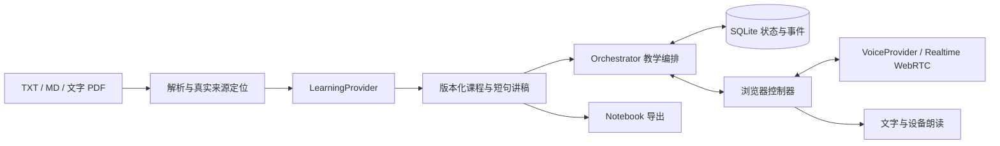
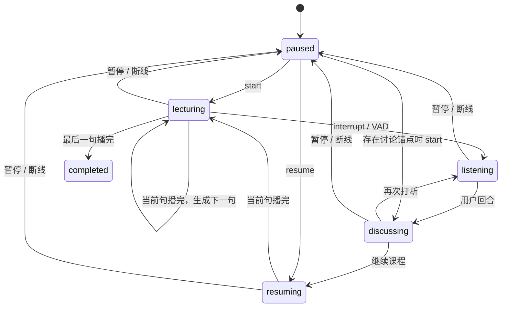

# 走马 · Zouma v0.2 架构与状态流

走马的产品定位是 Conversation-Native Adaptive Learning System。系统围绕“讲授 → 说话打断 → 多轮讨论 → 恢复主线”组织，以持久状态支持跨场景持续学习。课程位置是应用数据，不能依赖模型聊天记忆。沿用 Python/FastAPI、SQLite 和原生 HTML/CSS/JavaScript，先验证短课程闭环，再增加基础设施。知识追踪、自适应教学与多模态连续切换属于后续阶段，当前品牌更新不改变技术架构或完成状态。

## 模块边界

| 模块 | 职责 |
| --- | --- |
| `ingestion.py` | 有界材料提取、行号和 PDF 页码；不抓取远程内容，不做 OCR |
| `schemas.py` | 课程、讲解单元、原文、教学改写、练习和旧版会话契约 |
| `providers.py` | DemoProvider 与兼容 Chat Completions 的课程生成/文字问答 |
| `orchestration.py` | 权威主线、讨论锚点、输出任务、连接归属、状态迁移与事件 |
| `voice.py` | 可替换语音接口；当前以 OpenAI Realtime 统一接口协商 SDP |
| `storage.py` | SQLite 事务、课程、旧版会话/问答和学习事件 |
| `web/realtime.js` | WebRTC、麦克风、供应商事件、取消、播放确认与迟到事件隔离 |
| `web/app.js` | 导入、续学、讲稿、实时入口及文字/设备朗读降级 |
| `main.py` | 同源 HTTP 边界、配置摘要、接口与 Notebook 导出 |

课程 `source_excerpt/source_locator` 由解析结果填充，模型无权改写。`script` 是教学改写；`supplemental_notes` 单独记录补充解释，目标、先修和检查题也与原文分开。课程生成后不原位重写；课程 ID、单元 ID 和课程内容散列共同防止旧位置指向新内容。

## 首版语音取舍

采用原生 Realtime WebRTC，浏览器通过麦克风媒体轨上传音频，通过远端媒体轨播放，数据通道传递控制事件。应用服务端将 SDP 和配置发往 `/realtime/calls`，仅把 SDP answer 返回浏览器，永久密钥留在服务端。供应商专有会话不保存为课程状态。[官方连接说明](https://developers.openai.com/api/docs/guides/voice-webrtc)

这一选择减少首版拼接 STT、LLM、TTS 三条流的工作，便于尽快验证自由讨论和 VAD 打断；代价是供应商事件适配、持续语音成本及模型发声与固定讲稿之间的差异。当前按一句课程创建一次输出，恢复清楚，但可能增加句间等待和请求开销。延迟、费用和口述一致性需要真实实测；后续可在同一接口下加入组合语音方案。

VAD 保持 `create_response=false`，由应用控制何时回答，避免模型自行推进课程。用户开始说话时，本地先静音，随后取消生成并清空语音缓冲；自动转写完成后，应用保存用户回合、创建讨论任务，语音模型再回答。每次讨论任务显式提供课程依据与最近讨论，不把课程恢复交给模型推测。[Realtime 对话与打断](https://developers.openai.com/api/docs/guides/realtime-conversations)

## 教学状态

`segment_index/sentence_index` 指向下一句尚未确认完整播完的课程。`resume_anchor` 在首次打断时保存，后续讨论回合不会移动它。用户说“继续课程”或手动恢复后，应用恢复锚点并生成同一句；只有明确续学指令才恢复，包含这些词的普通问题不会直接跳转。

`utterance` 是当前一次输出任务，含独立 ID 和 `lecture/discussion` 类型。只有对应任务的 `heard` 才能完成输出。课程输出确认后移动一句；讨论输出确认后保存已播完的回答转写，继续停留在讨论状态。未完整结束的回答不冒充已完成记录。

## 检查点与竞态

实时路径同时要求生成成功 `response.done(status=completed)`、供应商音频缓冲播完 `output_audio_buffer.stopped`、本地播放器已启动且未静音、连接仍有效，再发送 `heard`。讲授还要求语音转写与当前短句归一化后相同；不一致时暂停，不把模型改写认定为原句听完。这个保守规则可能把数字或公式的合法口述差异也判为不一致，需要重试或使用设备朗读。单独收到 `response.done`、转写结束或发送任务都不能前进。浏览器设备/系统声量和学习者是否听懂无法由这些事件证明。

SQLite 使用写事务比较 `revision` 后提交状态与事件。`claim` 生成新的 `connection_id`，使之前页面的连接失去写入权；这是归属标识，没有按时间自动到期的租期。后续命令必须同时匹配版本和连接，播放确认还必须匹配 `utterance_id`。旧请求返回 409，携带当前权威状态，客户端停止旧输出并重新连接。

客户端另用连接代次、回合代次和响应 ID 隔离旧数据通道、旧课程、旧转写和迟到回答。命令按顺序排队，快速多次打断不会把旧音频结束事件当作新句完成。

刷新与断线不会确认待播句。重连先重新认领；服务重启清除连接和未确认任务、保留检查点与讨论锚点，进入暂停。关闭页面的最终保存属于尽力提交，恢复正确性依赖已提交的逐句检查点，不能依赖最后一次请求一定成功。

## 数据与扩展

个人服务器部署沿用同一个 FastAPI/SQLite 后端，浏览器和未来 iPhone 客户端共享服务端课程与检查点。Caddy 负责 HTTPS 和整站个人密码，应用仅在容器网络内监听；`AFL_PUBLIC_ORIGIN` 显式固定公开地址及可信主机，不放开跨站写入。数据库置于独立持久卷，单进程启动。部署文件及原生客户端接入边界见 [SERVER_DEPLOYMENT](SERVER_DEPLOYMENT.md)。这仍不是多用户系统，用户身份与数据隔离需在开放独立账号前实现。

Render 单服务路径使用平台 HTTPS 与应用内部 `PersonalAccessMiddleware`，无需 Caddy。`RENDER=true` 时必须配置个人用户名、随机长密码和公开 HTTPS 地址；未配置即拒绝启动。除固定的只读 `/health` 外整站认证，认证后的浏览器写入仍检查同源，响应禁止缓存。默认公开地址取平台 `RENDER_EXTERNAL_URL`，数据库写入 1 GB 持久磁盘 `/var/data`；保持一个服务实例和一个进程。`render.yaml` 使用 Python 原生运行环境，部署步骤见 [RENDER_DEPLOYMENT](RENDER_DEPLOYMENT.md)。

`learning_states` 保存主线、课程散列、讨论锚点、回合和当前任务；`events` 保存每次学习命令、用户回合、已完成回答及观测延迟。实时状态保留最近 200 条回合，讨论提示使用最近 20 条；完整已记录回合仍在事件表。旧 `sessions/qa` 表保留；旧播放位置保存会在同一事务同步新主线，并使旧语音连接失效，避免切换降级模式后位置漂移。

可观察的学习事件与掌握度推断必须分开。目前只记录收听/讨论行为，没有掌握度模型。P1 再加入解释、小测和实践证据，区分听过、复述、解释、迁移与独立解题；P2 据此安排教学策略和隔离代码实践。

没有引入多 Agent 对话框架、向量库、Redis 或任务队列。当前短材料同步生成、SQLite 单用户运行足以支持验证；明确出现长任务、多用户或检索需求后再演进。服务端不执行教材或模型生成的任意代码。
