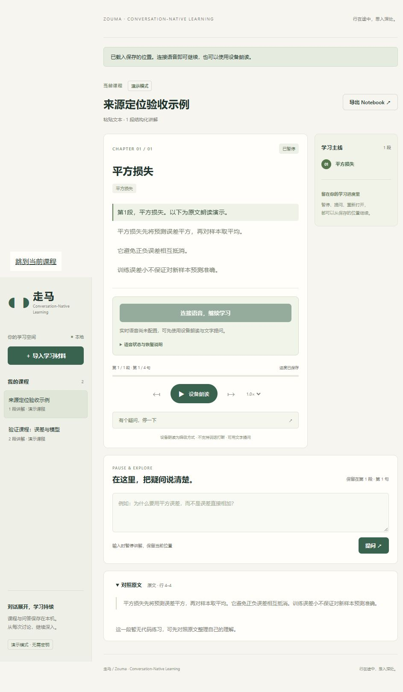

# 走马 · Zouma 验证记录 · 2026-10-27

当前结论：本地可运行，课程与状态编排自动化通过，浏览器降级流程已检查。**真实文本模型与实时语音服务未联调，P0 未完成验收。** 本次没有配置服务密钥，没有发起付费模型或语音调用。

## 环境与复现

Windows、Python 3.12.14；在当前工作区新建 `.venv`，依照 `requirements-lock.txt` 安装 `.[dev]`，没有依赖旧项目环境。启动过程只调用本地演示服务。

```powershell
.\.venv\Scripts\python.exe -m pytest --basetemp=data/test-validation
node --test tests/realtime.test.mjs tests/app.test.mjs
node --check audio_learning/web/app.js
node --check audio_learning/web/realtime.js
.\start.ps1 -Port 8010
```

本次 8000 端口已有其他服务，因此实际验证地址是 [127.0.0.1:8010](http://127.0.0.1:8010)。没有停止或修改原有 8000 服务。Python 在执行沙箱内初始化 `socketpair` 时挂起；本机执行相同测试正常，因此 HTTP 测试及服务启动通过本机执行完成。这属于执行环境限制，不是省略测试。

## 自动化结果

| 检查 | 结果 | 实际覆盖 |
| --- | --- | --- |
| Python 全量测试 | **82 项通过** | 导入、真实来源索引、课程结构、兼容模型协议、持久化、版本冲突、问答失败与迟到回答、独立讨论锚点、旧连接失效、并发/重复播放确认、重启恢复、语音协商协议和失败清理、跨源写入与异常 Host 拒绝、密钥不下发、文字与语音进度接管 |
| Node 语音与界面集成测试 | **24 项通过** | 15 项模拟 WebRTC/供应商事件测试：生成与播放完成的先后顺序、快速打断、清缓冲、迟到确认、课程切换、指标不重播、讨论中继续、麦克风授权迟到、播放被阻止、未配置服务、课程完成释放麦克风、错误/缺失转录、数学数字差异、冲突时不关闭其他页面的连接；另有 9 项真实 app.js 函数的边界替身集成测试，检查重连/切课/关闭页面保留讨论锚点、自动结束后的版本交接、首次重听/定位无需重试 |
| JavaScript 语法 | 通过 | `app.js` 与 `realtime.js` |

后端有一条依赖弃用提示：Starlette 的 TestClient 建议改用 `httpx2`。当前锁定的 `httpx` 测试仍全部通过。未为消除提示改动原有依赖接口。

模型响应和 SDP 均使用模拟上游。Node 测试也使用模拟媒体与事件，不能证明真实麦克风、音频输出、VAD 或供应商延迟达标。GitHub Actions 已配置 Python 与 Node 检查，本次未推送或运行远程 CI。

## 实际浏览器交互

在应用内浏览器打开实际本地服务，完成以下检查：

1. 粘贴短讲义，生成两段演示课程；界面明确标记模板演示。
2. 手动定位到第 2 段第 1 句，保存位置。
3. 连续提交两个文字问题，检查问题和演示回答均保留，课程位置没有漂移。
4. 刷新页面，恢复第 2 段第 1 句，两轮问答仍可见。
5. 点击继续主线，界面进入设备朗读状态；手动打断后回到暂停。此处仅核对控件和状态，没有进行耳机声学验收。
6. 停止并重启本次创建的 8010 服务，刷新后课程、非零章节位置和两轮问答仍在。
7. 再次导入含两行前导空行的讲义，确认正文来源显示为实际 **第 4 行**，展开后原文一致。检查中发现并修复前端提交正文时 `.trim()` 导致定位偏移的问题。
8. 未配置语音时，实时连接按钮禁用并解释可用的文字/设备朗读路径；没有请求麦克风权限或创建真实语音会话。
9. 浏览器错误与警告日志为空；桌面截图检查未发现内容遮挡。



## 品牌更新复核 · 2026-10-28

正式品牌为「走马 / Zouma」，Slogan 为「行在途中，思入深处。」，产品定位为 Conversation-Native Adaptive Learning System。浏览器标题、首页、导航、页脚、OpenAPI 展示和 Notebook 导出署名已同步；原界面截图已更新，移除没有文档引用的旧品牌预览图。

品牌变更后重新运行：82 项 Python 测试、24 项 Node 测试及 JavaScript 语法检查全部通过；可编辑安装包构建通过，安装元数据包含 Zouma。Python 分发标识、模块导入、环境变量、API 和数据库结构保持兼容。已有课程与问答正常载入。

实际检查 320、390、768、958 像素宽度：页面没有横向溢出，品牌名称与导入按钮未重叠。欢迎页展示对话原生定位，演示模式和真实服务未验收的说明仍在。截图来自当前应用，不代表真实语音验收。

品牌规范与保留标识详见 [BRAND](BRAND.md)。当前 GitHub 地址保持原样，`zouma-learning` 尚未执行仓库改名。

## 尚未执行的真实 P0 验收

真实文本课程生成、实时麦克风输入、自然语音打断、多轮相关自由讨论、口头恢复与真实输出音频均待供应商服务配置后执行。还需核对材料忠实度、概念覆盖、公式口述、合法转写差异和长讨论上下文。

| 指标 | 本次记录 |
| --- | --- |
| 用户开始发声 → AI 实际停止出声 | 未测量 |
| 用户说完 → 回答实际开始出声 | 未测量 |
| 真实语音恢复位置正确性 | 未验收；自动化检查点测试通过 |
| 意外跳课/大段重复/状态丢失次数 | 无真实语音样本，不能报告为零 |
| 有效学习的操作负担 | 已检查主要入口；尚无真实散步/通勤用户测量 |

界面中的 `interruption_stop_ms` 是收到 VAD 事件到本地静音的处理时间，`response_start_ms` 是说话结束事件到输出缓冲开始事件，均为事件代理。它们不包含完整声学链路，不应作为上述实际延迟的替代。

下一次按 [ROADMAP](ROADMAP.md) 的完整 12 步路径，结合耳机与短讲义记录供应商、模型、浏览器、网络条件、真实延迟及异常次数。只有真实路径和失败恢复都通过后，才将 P0 标为完成。
